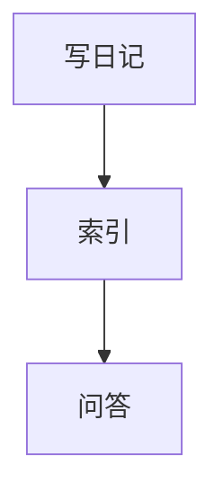

# Markdown 书写指南（v2.5）

MDiary 的正文是标准 Markdown（GFM 子集），预览支持**数学公式**和 **Mermaid 图源码**，
编辑器工具栏的「符号与公式」（`Icons.functions`）可以直接插入常用符号。

## 1. 数学公式

| 写法 | 效果 |
|---|---|
| `$E=mc^2$` | 行内公式，和文字同一行 |
| `$$\frac{a}{b}$$` | 单行块级公式，居中显示 |
| 多行 `$$` … `$$` | 块级公式，居中显示 |

支持的 TeX 子集由 `flutter_math_fork` 提供：分数、根号、上下标、求和、积分、极限、矩阵、
希腊字母、关系符等。解析失败时预览会显示红色错误块和原始 TeX，不会整段消失。

例：

```markdown
质能方程 $E=mc^2$。

$$
\int_{0}^{1} x^2 \, dx = \frac{1}{3}
$$
```

> 提示：货币里的 `$` 单独出现（没有配对的 `$`）不会被当成公式。

## 2. Mermaid 图

用围栏代码块，语言写 `mermaid`：

````markdown

````

**当前版本（2.5）**：预览显示「Mermaid 图」卡片，保留完整源码并可一键复制，
粘贴到 [mermaid.live](https://mermaid.live) 查看渲染结果。

> 真实渲染需要 WebView2 + 内置 mermaid.js；构建依赖 NuGet 上的 WebView2 SDK，
> 当前构建机取不到该依赖，因此暂以源码卡片交付（见 `docs/reviews/2026-11-09-markdown-v2.5.md`）。

## 2.5 表情短代码（v2.5.1）

正文里写 `:smile:`、`:heart:`、`:微笑:` 这类短代码，预览时显示为表情：

- 内置约 90 个常用短代码（英文 + 常用中文别名），见 `lib/core/emoji.dart`；
- 编辑器工具栏「表情」打开面板：搜索、点选插入（插入的是 `:code: `，源码仍可读）；
- **可覆盖/可新增**：面板里「自定义」填短代码 + 显示内容（emoji 或任意短文字），
  自定义优先于内置；删除自定义后恢复内置；
- 映射存 meta 表 `emoji_custom`（JSON），换库不影响；
- 围栏代码块与行内代码里的 `:smile:` 不会被替换。

## 3. 常用符号提示表

编辑器工具栏 →「符号与公式」：

| 分组 | 内容 |
|---|---|
| Markdown 结构 | 标题、粗体、斜体、删除线、引用、列表、任务、行内码、代码块、链接、图片、表格、分隔线 |
| 数学公式 | 行内/块级公式、分数、上下标、根号、求和、积分、极限、乘除、比较、无穷 |
| 希腊字母 | α β γ δ ε θ λ μ π σ φ ω Δ Σ Ω |
| 箭头 | → ← ↑ ↓ ⇒ ⇐ ↔ ⇔ |
| 逻辑与集合 | ∈ ∉ ⊂ ⊆ ∪ ∩ ∀ ∃ ∅ ≤ ≥ ≠ ≈ ± × ÷ ∞ |
| 常用符号 | ° ℃ ‰ § ¶ • … — – € ¥ ✓ |

行为：

- 有选区时用选区替换占位符（例如选中「重点」点粗体 → `**重点**`）；
- 无选区时插入占位符并选中它，直接打字即可替换；
- 面板保持打开，可以连续插入。

## 4. 外观设置

设置 → 外观：

| 项 | 说明 |
|---|---|
| 主题 | 跟随系统 / 浅色 / 深色（存 `meta` 表 `theme_mode`） |
| 编辑器字号 | 12–28（`editor_font_size`） |
| 界面字体 | 默认 / 微软雅黑 UI / 微软雅黑 / Segoe UI / 宋体 / 思源黑体（`ui_font`） |
| 编辑器字体 | Cascadia Mono / Consolas / Courier New / 微软雅黑（`editor_font`） |

字体只用系统已安装的，不增加安装包体积；换了机器没装所选字体会自动回落到默认字体链。

## 5. 渲染技术栈

| 层 | 技术 |
|---|---|
| 解析 | `markdown 7.3.1`（GFM），行内公式用自定义 `InlineSyntax` |
| 渲染 | `flutter_markdown_plus 1.0.12`，块级公式 / Mermaid 在渲染前拆段 |
| 公式 | `flutter_math_fork 0.7.4`（纯 Dart，无 WebView） |
| 附件 | `imageBuilder` 从 SQLite 落临时文件后 `Image.file` |

## 6. 已知限制

- Mermaid 目前只展示源码（真实渲染待 WebView2 构建打通）；
- 数学公式不支持 `\begin{align}` 之类复杂环境之外的扩展包；
- 块级公式宽度超出时横向滚动，不自动换行；
- 符号提示表是固定的常用集合，不支持自定义。
## 7. 编辑体验（v2.8）

| 功能 | 入口 |
|---|---|
| 语法高亮（标题/粗体/代码/公式/链接） | 默认开启（自定义 `TextEditingController`） |
| 行号 + 当前行号高亮 | 编辑区左侧 |
| 自动配对 `()[]``""''` | 输入时自动补另一半，选中文字会被包住 |
| 列表续行 / Tab 缩进 | 回车自动续 `-`/`1.`，空项回车退出；Tab / Shift+Tab 缩进 |
| 查找替换 | Ctrl+F 或工具栏「编辑工具」 |
| 大纲 | 工具栏「编辑工具」→ 大纲，点击跳到标题 |
| 命令面板 | Ctrl+P 或工具栏，插入表格/公式/Mermaid |

限制：行号栏只跟随纵向滚动，长行软换行时不重算；语法高亮是轻量正则，不是完整 AST。