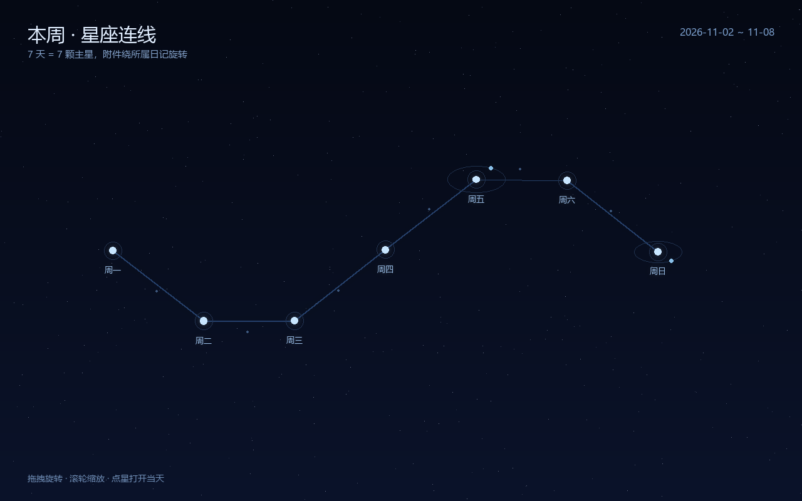
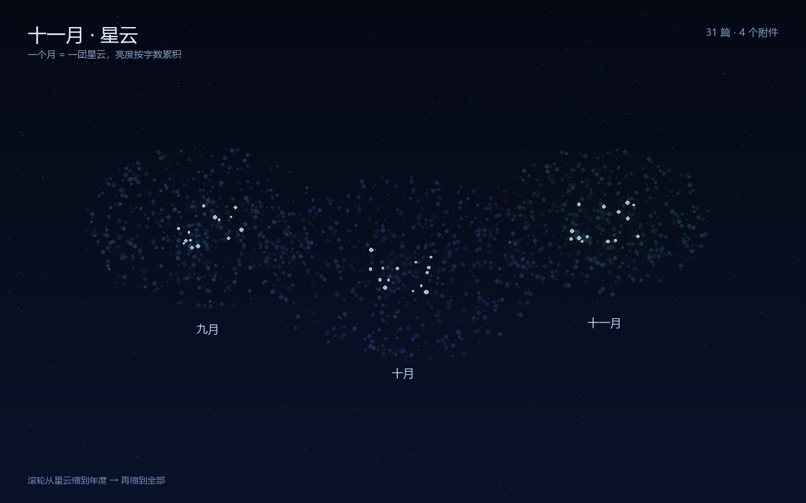
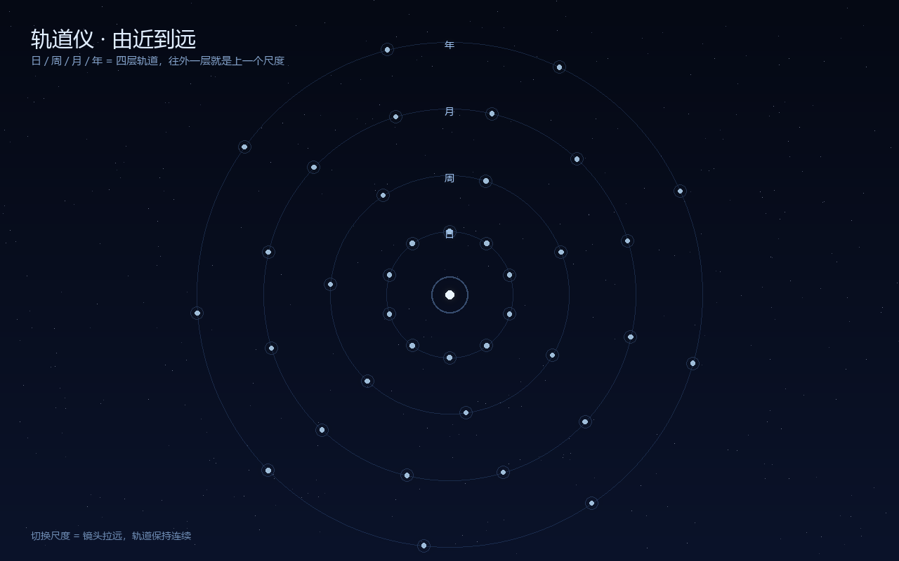
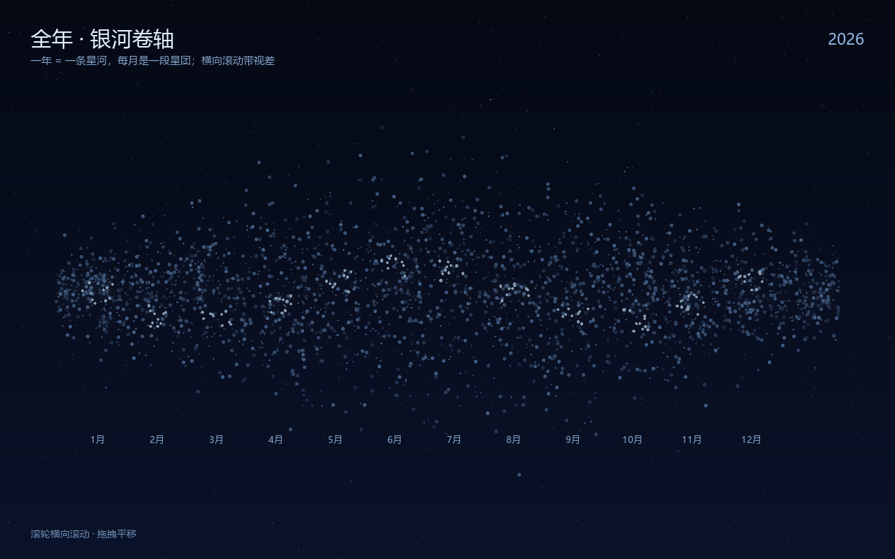

# 星图（Star Map）概念稿 v1

> 目标：把「日记 → 星座 → 星云 → 宇宙」做成可缩放的星图，而不是静态列表。
> 本文给 4 个方向，选中后再做实现（Flutter CustomPainter + Ticker，不引第三方图库）。

## 需求映射

| 尺度 | 数据 | 视觉 |
|---|---|---|
| 周 / 月 | 每日 `.md` | 星星连成**星座** |
| 周 / 月 | 附件 | 绕所属日记星**旋转**的小卫星 |
| 年 | 月 | 每月星座聚成**星云** |
| 总览 | 所有年 | 星云组成**宇宙** |

## 概念 A：星座连线（周 / 月）

- 7 天 = 7 颗主星，按日期顺序连成一条星座路径；星等 ∝ 字数（或当日篇数）；
- 附件 = 小卫星，沿椭圆轨道绕自己的日记星转，轨道线很淡；
- 有笔记的日子星更亮、有柔光；空白日只有极暗的小点，但保留位置；
- 相邻周/月以更暗的星群出现在边缘，暗示"还有别的星座"。

**动画**（GIF）：`star-map/concept-a.gif`

| 动作 | 参数 |
|---|---|
| 主星呼吸 | 2.4 s 循环，亮度 ±20%，错峰相位 |
| 附件公转 | 8–12 s/圈（每颗不同），轨道倾角固定 |
| 连线绘制 | 打开时 600 ms 依次生长（stroke dash） |
| 悬停 | 星放大 1.25×，显示日期 + 标题 + 篇数浮层 |
| 点击 | 相机推进到该星，打开当天日记 |

**优点**：最贴"每天一篇连成星座"的原意；信息可读（能看清哪天空着）。
**缺点**：到了"年"尺度 365 颗星会糊成一片，必须靠 B 的星云接管。

## 概念 B：星云粒子（年 / 总览）

- 一个月 = 一团星云（粒子云），粒子数量 ∝ 篇数，颜色按月相错开；
- 星云里最亮的几颗是"有附件/字数多"的日子；
- 年视图：12 团星云排成一条悬臂；总览：多团星云组成星系，中心是"全部日记"。

**动画**：`star-map/concept-b.gif`

| 动作 | 参数 |
|---|---|
| 粒子呼吸 | 整体缓慢旋转 60 s/圈，单粒子抖动 ±2 px |
| 悬停星云 | 外发光增强，显示「11 月 · 31 篇 · 4 附件」 |
| 点击星云 | 粒子散开成星座（过渡 700 ms，A 的形态） |
| 缩放 | 星云 ↔ 星座连续插值，不是硬切页 |

**优点**：远看有"宇宙感"，年度/总览不糊；缩放叙事自然。
**缺点**：近看不如 A 清楚；粒子多时对绘制性能敏感。

## 概念 C：轨道仪（尺度导航）

- 中心是"今日"，向外四层轨道：日 → 周 → 月 → 年；每层轨道上的点是对应尺度的一个条目；
- 切换尺度 = 相机拉远，轨道连续放大/缩小，不是切换页面；
- 附件挂在所属轨道内侧的短弧上。

**动画**：`star-map/concept-c.gif`

| 动作 | 参数 |
|---|---|
| 轨道旋转 | 不同层不同角速度（外层慢），60 s 级 |
| 尺度切换 | 600 ms 缓动，轨道缩放 + 透明度渐变 |
| 悬停 | 高亮整条轨道（表示"这一周/这一月"） |

**优点**：导航心智清晰，永远知道"我在哪个尺度"。
**缺点**：星座叙事弱，更像仪表盘；和"星座/星云"的意象不完全一致。

## 概念 D：银河卷轴（年度横向）

- 一年 = 一条横向星河，每月一段星团；横向滚动，带视差（远层慢、近层快）；
- 滚轮横向移动，点击某段进入该月星座。

**优点**：适合"按时间翻年"的操作习惯；实现简单。
**缺点**：只适合年度，周/月仍需另一套视图；不够"宇宙"。

## 对比

| 维度 | A 星座 | B 星云 | C 轨道仪 | D 卷轴 |
|---|---|---|---|---|
| 贴合需求 | ★★★★★ | ★★★★ | ★★★ | ★★ |
| 周/月可读性 | ★★★★★ | ★★★ | ★★★★ | ★★ |
| 年/总览观感 | ★★ | ★★★★★ | ★★★ | ★★★★ |
| 动画表现力 | ★★★★ | ★★★★★ | ★★★ | ★★★ |
| 实现难度（1–5） | 2 | 4 | 3 | 1 |
| 性能风险 | 低 | 中（粒子） | 低 | 低 |

## 推荐：A + B 的连续缩放（把 C 的导航逻辑藏在里面）

1. **周/月**用 A：星座 + 附件公转 + 呼吸；
2. **年**：镜头拉远，星座按"月"聚成 B 的星云（同一批星，位置插值）；
3. **总览**：继续拉远，星云变成星系，中心亮点是"全部"；
4. 缩放全程 700 ms 插值，避免硬切；缩到很近时才显示日期文字（LOD）。

这样既满足"每天连成星座"，又有"星云/宇宙"的远景，且只需一套数据模型：
`Entry → 星（位置由日期决定） → 星座（周/月分组） → 星云（月分组） → 星系（年分组）`。

## 实现草案（选中后）

- `StarMapController`：持有时间窗口、缩放级别（week/month/year/all）、相机（中心/缩放）；
- 布局：日期 → 角度/半径（确定性，不用随机，保证同一天位置稳定）；
- 绘制：`CustomPainter` 三层（星云粒子 → 连线 → 星与标签），`RepaintBoundary` 隔离；
- 动画：单个 `Ticker` 驱动 phase，避免每颗星一个 controller；粒子数上限 2000，按缩放 LOD 降采样；
- 交互：拖拽旋转、滚轮缩放、点击打开日记、悬停浮层；
- 性能目标：60 fps（1080p），空库 < 50 ms 首帧。

## 文件

| 文件 | 说明 |
|---|---|
| `docs/star-map/concept-a.png` / `.gif` | 星座连线（静态 + 动画） |
| `docs/star-map/concept-b.png` / `.gif` | 星云粒子 |
| `docs/star-map/concept-c.png` / `.gif` | 轨道仪 |
| `docs/star-map/concept-d.png` | 银河卷轴 |
| `tool/star_map_mock.py` | 生成上述概念稿的脚本（Pillow） |
